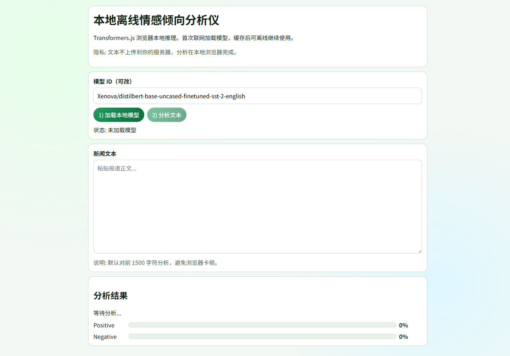

# P02 本地离线情感倾向分析仪

## 用途

在浏览器本地对新闻文本做情感倾向分析，辅助检查报道语气是否过度倾向。

## 使用

1. 打开 `index.html`。
2. 点击“加载本地模型”（首次联网下载，后续走浏览器缓存）。
3. 粘贴文本并点击“分析文本”。

## 隐私

- 无后端上传逻辑。
- 文本在浏览器本地推理。

## 限制

- 默认模型偏英文语料，中文效果可能不稳定。
- 当前默认分析前 1500 字符以控制性能。


## 已知限制

- 仅支持现代 Chromium 内核浏览器 (Chrome 110+, Edge 110+)。
- 词典覆盖不全导致误判。
- 本工具为前端纯静态实现，不含后端服务。
## 产品化优化（PM）

### 优化目标
- 降低新用户上手门槛，并提升首轮输出质量稳定性。

### 目标用户
- 一线用户：希望在 3 分钟内完成核心任务的内容/数据/核查从业者。
- 管理者：关注输出质量稳定性、效率提升和可复用流程。

### 核心使用场景
- 采访前快速生成对比草稿
- 编辑复核口径偏差与幻觉
- 形成可复制的报道工作流

### 北极星指标（上线后 2 周）
- 首次任务完成率 >= 70%
- 核心任务完成时长 P50 <= 3 分钟
- 7 日回访率 >= 20%

### 下一步迭代（按优先级）
1. 新增默认示例与一键体验路径
2. 加入输出质量评分与纠错建议
3. 提供多模板导出（稿件/提纲）

## 数据化追踪（PM）

### 已接入埋点事件
- `page_view`：页面访问
- `first_interaction`：首次交互时延
- `cta_click`：核心按钮点击
- `task_start` / `task_complete` / `task_error`：核心任务生命周期
- `status_success_signal` / `status_error_signal`：状态文本成功/失败信号
- `page_hidden` / `page_unload`：页面停留与离开

### 看板字段（统一）
- `project_id`（例如：P02-offline-sentiment）
- `project_cluster`
- `session_id`
- `event_name`
- `event_time`
- `page_path`
- `control_id`
- `task_name`（当前项目默认：content_generation_core_task）
- `task_duration_ms`
- `elapsed_ms`
- `status_text`

### 本地查看与导出
在浏览器控制台执行：

```js
window.pmMetrics.getSummary()
window.pmMetrics.exportEvents()
```

### 上线后两周目标
- 首次交互时延 P50 <= 10 秒
- 核心任务完成率 >= 70%
- 核心任务完成时长 P50 <= 180 秒

<!-- PLAYWRIGHT_REVIEW:START -->
## 页面效果截图（Playwright）

> Captured: 2026-03-02T09:19:19.915Z | Mode: headed (non-headless)



## 可改进点（自动巡检）
- 修复浏览器控制台报错，降低运行时故障和功能中断风险。

- 巡检信号：console_error=1，request_failed=0，load_ms=3680
- 页面标题：P02 本地离线情感倾向分析仪

<!-- PLAYWRIGHT_REVIEW:END -->

